# Machine Learning Fundamentals

Hands-on Jupyter notebooks covering the core **supervised** and **unsupervised** machine-learning algorithms with Python, NumPy, pandas, Matplotlib/Seaborn and scikit-learn - including several algorithms **implemented from scratch** (linear regression with gradient descent, logistic regression, K-Nearest Neighbours) and checked against scikit-learn.

Every notebook runs top-to-bottom on the pinned environment below, and every number in this README comes from those saved outputs.

  

---

## Contents

| # | Topic | Notebook | Dataset | What it shows |
|---|---|---|---|---|
| **Supervised** |||||
| 1 | Linear regression | [house_price_prediction](supervised/01-linear-regression/house_price_prediction.ipynb) | House prices (Kaggle subset) | cleaning, one-hot encoding, **linear regression from scratch (gradient descent)** |
| | | [insurance_charges](supervised/01-linear-regression/insurance_charges.ipynb) | Medical insurance | EDA, R² and adjusted R² |
| 2 | Regularisation | [lasso_regression](supervised/02-regularization/lasso_regression.ipynb) | Medical insurance | interaction features, L1 penalty, `LassoCV` |
| 3 | Logistic regression | [logistic_regression_heart](supervised/03-logistic-regression/logistic_regression_heart.ipynb) | Heart disease | confusion matrix, precision / recall / F1, scaling |
| | | [employee_turnover_regularization](supervised/03-logistic-regression/employee_turnover_regularization.ipynb) | Employee turnover | L1 vs L2, **logistic regression from scratch** |
| 4 | K-Nearest Neighbours | [knn_iris_from_scratch](supervised/04-knn/knn_iris_from_scratch.ipynb) | Iris | **KNN from scratch** vs scikit-learn KNN / LogReg / Naive Bayes |
| | | [knn_heart_gridsearchcv](supervised/04-knn/knn_heart_gridsearchcv.ipynb) | Heart disease | choosing *k*, `GridSearchCV`, `Pipeline` |
| 5 | Naive Bayes | [naive_bayes_heart](supervised/05-naive-bayes/naive_bayes_heart.ipynb) | Heart disease | `GaussianNB` |
| 6 | Support Vector Machines | [svc_iris](supervised/06-svm/svc_iris.ipynb) | Iris | kernels, `C`, CV-tuned pipeline |
| | | [svr_diabetes](supervised/06-svm/svr_diabetes.ipynb) | Diabetes | SVR kernels, `epsilon`, `GridSearchCV`, `LinearSVR` |
| 7 | Decision trees | [decision_tree_classifier_titanic](supervised/07-decision-trees/decision_tree_classifier_titanic.ipynb) | Titanic | pre-pruning, **cost-complexity post-pruning**, tree plots |
| | | [decision_tree_regressor_diabetes](supervised/07-decision-trees/decision_tree_regressor_diabetes.ipynb) | Diabetes | regression tree, over-fitting check |
| | | [shop_smart_purchase_prediction](supervised/07-decision-trees/shop_smart_purchase_prediction.ipynb) | Online shoppers (UCI) | `ColumnTransformer` + `Pipeline`, imbalanced data, F1 |
| 8 | Ensembles | [random_forest_bagging_titanic](supervised/08-ensembles/random_forest_bagging_titanic.ipynb) | Titanic | random forest + OOB score, bagging |
| | | [adaboost_classifier](supervised/08-ensembles/adaboost_classifier.ipynb) | synthetic | AdaBoost with decision stumps |
| | | [gradient_boosting_classifier](supervised/08-ensembles/gradient_boosting_classifier.ipynb) / [regressor](supervised/08-ensembles/gradient_boosting_regressor.ipynb) | synthetic | gradient boosting |
| | | [xgboost_classifier](supervised/08-ensembles/xgboost_classifier.ipynb) | synthetic | XGBoost vs scikit-learn GB |
| ★ | **Mini project** | [CreditWise - loan approval](supervised/projects/credit-wise-loan-approval/) | Loan applications | end-to-end: EDA → encoding → 3 models → feature engineering |
| **Unsupervised** |||||
| 1 | K-Means | [kmeans_iris](unsupervised/01-kmeans/kmeans_iris.ipynb) | Iris | PCA + elbow + K-Means, silhouette, ARI |
| | | [kmeans_elbow_silhouette_blobs](unsupervised/01-kmeans/kmeans_elbow_silhouette_blobs.ipynb) | synthetic blobs | elbow, `kneed` knee detection, silhouette |
| 2 | Hierarchical | [hierarchical_clustering_iris](unsupervised/02-hierarchical/hierarchical_clustering_iris.ipynb) | Iris | Ward linkage, dendrogram |
| 3 | DBSCAN | [dbscan_vs_kmeans](unsupervised/03-dbscan/dbscan_vs_kmeans.ipynb) | Iris, moons | density clustering vs K-Means on non-linear shapes |
| 4 | PCA | [pca_iris](unsupervised/04-pca/pca_iris.ipynb) | Iris | explained variance, loadings, 2-D projection |
| 5 | Anomaly detection | [isolation_forest_lof_thyroid](unsupervised/05-anomaly-detection/isolation_forest_lof_thyroid.ipynb) | Thyroid | Isolation Forest, LOF, evaluation vs labels |

---

## Results at a glance

All scores are on a **held-out test set** that was not used for training or tuning. Each row uses a different dataset, so compare models *within* a dataset, not across rows.

<p align="center">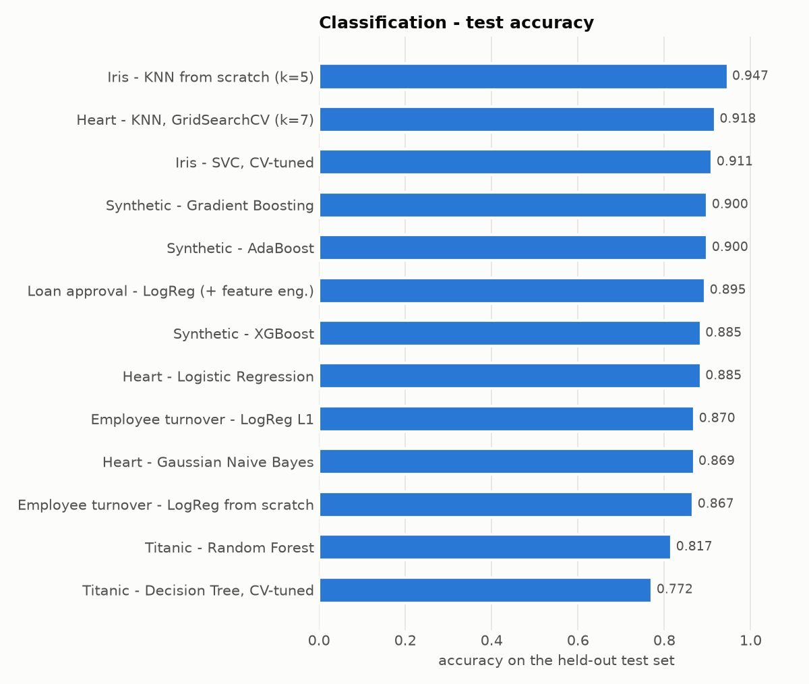</p>

<p align="center">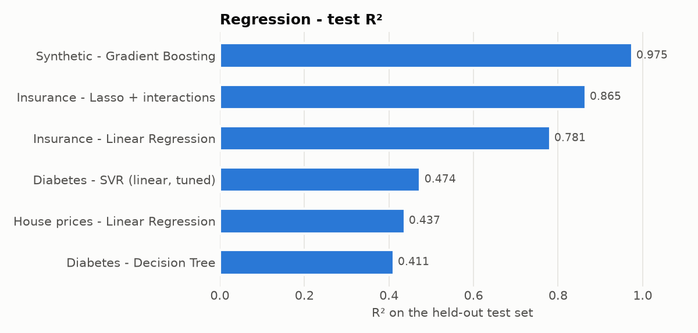</p>

<p align="center">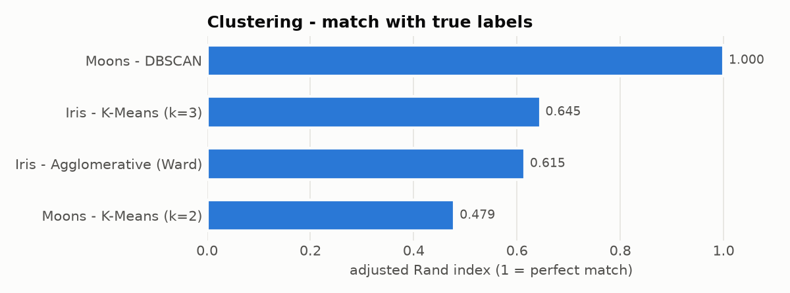</p>

<details>
<summary><b>Full results table</b></summary>

| Notebook | Model | Metric (test set) |
|---|---|---|
| house_price_prediction | LinearRegression / from-scratch GD | R² 0.437 / 0.437, MAE ≈ 34.7k, MAPE 20.6 % |
| insurance_charges | LinearRegression | R² 0.781, adjusted R² 0.777 |
| lasso_regression | LassoCV (α = 0.001) + interaction features | R² 0.865 |
| logistic_regression_heart | LogisticRegression | accuracy 0.885, recall 0.906, F1 0.892 |
| employee_turnover_regularization | baseline / L1 / L2 / from scratch | accuracy 0.859 / 0.870 / 0.859 / 0.867 |
| knn_iris_from_scratch | KNN from scratch / sklearn KNN / GaussianNB / LogReg | accuracy 0.947 / 0.947 / 0.987 / 1.000 (75 test flowers) |
| knn_heart_gridsearchcv | KNN, k = 7 chosen by 5-fold CV | accuracy 0.918, recall 0.906, precision 0.935 |
| naive_bayes_heart | GaussianNB | accuracy 0.869, recall 0.844, precision 0.900 |
| svc_iris | SVC (RBF, C = 0.5) chosen by CV | CV accuracy 0.981, test accuracy 0.911 |
| svr_diabetes | SVR (linear, C = 10) chosen by CV | R² 0.474 |
| decision_tree_classifier_titanic | tree tuned by CV | accuracy 0.772 (CV 0.806) |
| decision_tree_regressor_diabetes | DecisionTreeRegressor | R² 0.411 (train 0.545) |
| shop_smart_purchase_prediction | tree pipeline tuned for F1 | F1 0.623, recall 0.83 on buyers |
| random_forest_bagging_titanic | RandomForest / Bagging(tree) / Bagging(LogReg) | accuracy 0.817 / 0.769 / 0.795, OOB 0.822 |
| adaboost / gradient boosting / xgboost | synthetic classification | accuracy 0.900 / 0.900 / 0.885 |
| gradient_boosting_regressor | synthetic regression | R² 0.975 |
| credit_wise | LogReg / KNN / GaussianNB (after feature engineering) | F1 0.831 / 0.615 / 0.821 |
| kmeans_iris · hierarchical_clustering_iris | K-Means · Ward | ARI 0.645 · 0.615, silhouette 0.505 · 0.447 |
| dbscan_vs_kmeans (moons) | DBSCAN · K-Means | ARI 1.000 · 0.479 |
| isolation_forest_lof_thyroid | Isolation Forest · LOF (k = 20) | ROC-AUC 0.597 · 0.683, outlier recall 0.08 · 0.16 |

</details>

---

## Visual highlights

| | |
|---|---|
| 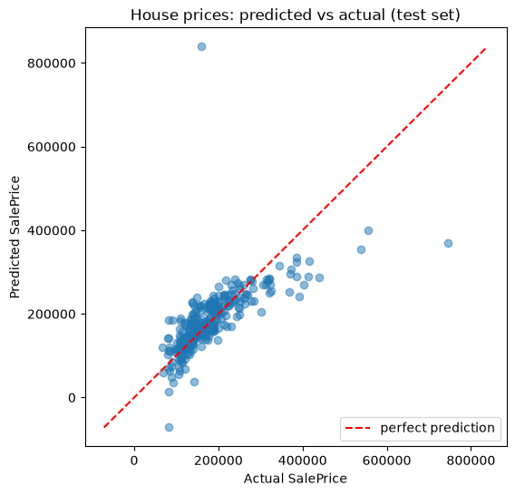 **Linear regression** - predicted vs actual house prices | 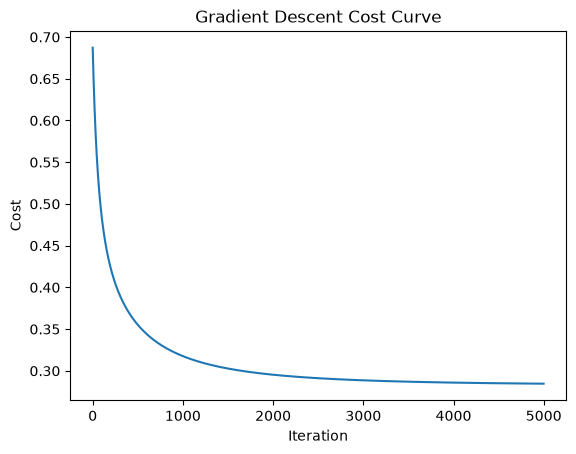 **Logistic regression from scratch** - cost falling during gradient descent |
| 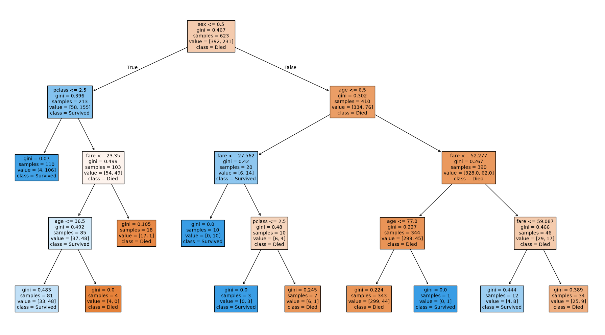 **Post-pruned decision tree** (Titanic) | 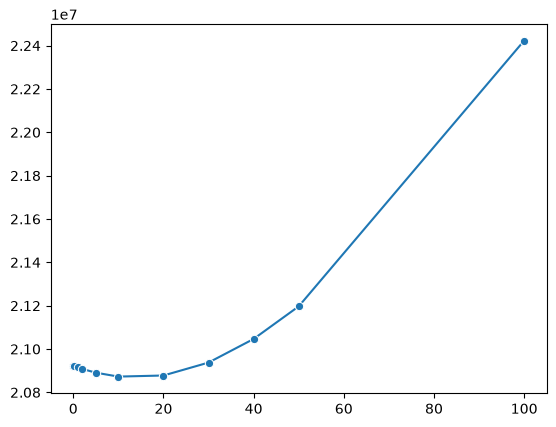 **Lasso** - test MSE as α grows |
| 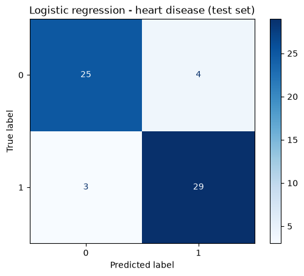 **Logistic regression** - heart-disease confusion matrix | 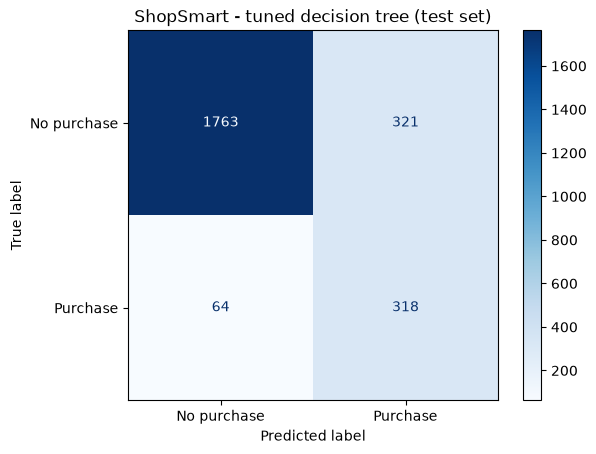 **ShopSmart** - imbalanced purchase prediction |
| 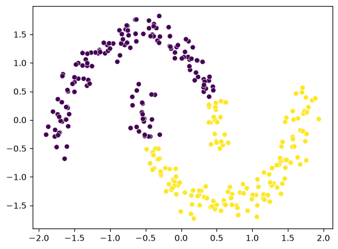 **K-Means on moons** - splits the shapes incorrectly | 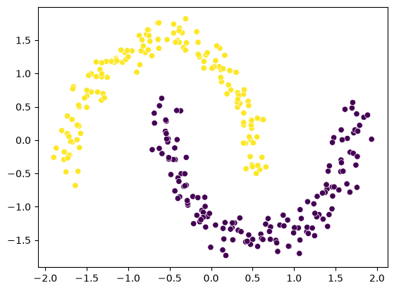 **DBSCAN on moons** - recovers both shapes |
| 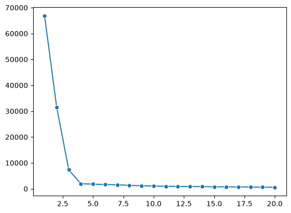 **Elbow method** on 4 synthetic blobs | 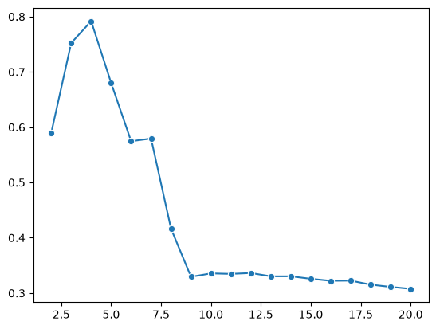 **Silhouette score** peaks at k = 4 |
| 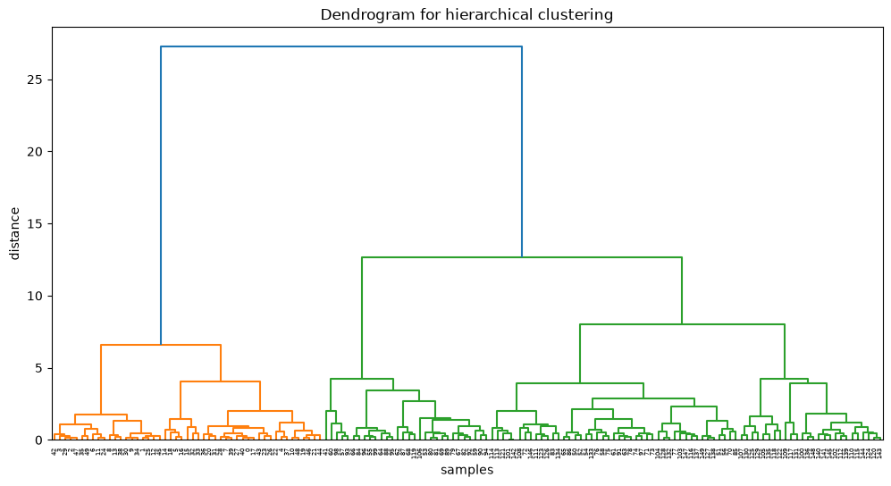 **Dendrogram** (Ward linkage, Iris) | 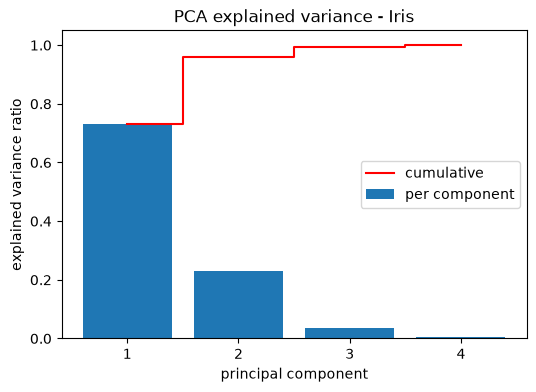 **PCA** - 2 components keep ~96 % of the variance |

---

## What I learned / key takeaways

- **Data leakage is easy to introduce.** Imputers and scalers are fit on the training rows only, row IDs are dropped (in `Iris.csv` the `Id` column alone predicts the species), and rows with a missing **target** are removed instead of being imputed.
- **Tuning on the test set gives optimistic scores.** In the Titanic decision-tree notebook, choosing `max_depth` by test accuracy reports 0.825, but the honest cross-validated pipeline scores 0.772 on the same test set.
- **The metric must match the problem.** Recall matters for disease screening, and F1 suits imbalanced purchase data. Clustering is scored with silhouette and adjusted Rand index.
- **From-scratch implementations match the library.** Gradient-descent linear regression reaches the same R² as `LinearRegression` (0.437), and scratch logistic regression matches scikit-learn's accuracy within 1 %.
- **Unsupervised ≠ labelled.** On the thyroid data, Isolation Forest and LOF find statistical outliers that only partly match the medical outlier labels (ROC-AUC 0.60-0.68). It's an honest negative result.

---

## Repository structure

```
machine-learning-fundamentals/
├── data/                  # all CSV datasets (see data/README.md for sources)
├── images/                # figures used in this README
├── scripts/               # make_results_charts.py - builds the summary charts
├── supervised/
│   ├── 01-linear-regression/ … 08-ensembles/
│   └── projects/credit-wise-loan-approval/
├── unsupervised/
│   └── 01-kmeans/ … 05-anomaly-detection/
├── requirements.txt
└── README.md
```

Titanic, Iris (sklearn), Diabetes and the synthetic datasets are loaded from `seaborn` / `scikit-learn` directly. The Titanic notebooks need an internet connection the first time, because `seaborn.load_dataset` downloads it.

## How to run

```bash
git clone https://github.com/<your-username>/machine-learning-fundamentals.git
cd machine-learning-fundamentals
python -m venv .venv
# Windows: .venv\Scripts\activate    |  macOS/Linux: source .venv/bin/activate
pip install -r requirements.txt
jupyter notebook
```

Open any notebook and choose **Run All**. Data paths are relative (`../../data/...`), so launch Jupyter from the repository root.


## Author

**Arpan Ghosh** - M.Tech CSE, Tripura University
