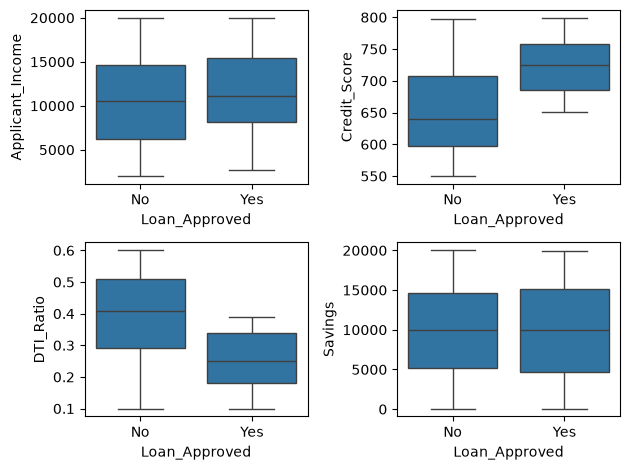
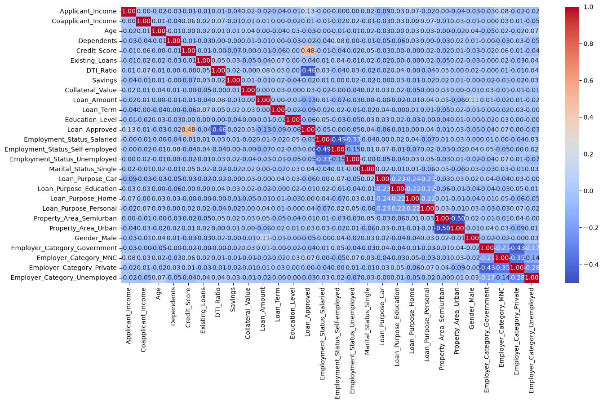

# CreditWise - Loan Approval Prediction

Predict whether a loan application is approved, using 19 applicant features (income, credit score, debt-to-income ratio, savings, collateral, employment, and so on).

**Notebook:** [credit_wise.ipynb](credit_wise.ipynb) · **Data:** [`data/loan_approval_data.csv`](../../../data/loan_approval_data.csv)

## Workflow

1. **Cleaning.** 50 rows with no `Loan_Approved` label are removed, because imputing the target would invent labels. The remaining missing values are imputed (mean or most frequent), using statistics from the training rows only.
2. **EDA.** Class balance (about 31 % approved), income distributions, box plots, and a correlation heatmap.
3. **Encoding.** Label-encode `Education_Level` and the target, and one-hot encode the 6 nominal columns.
4. **Split + scale.** 80/20 split, with `StandardScaler` fit on the training set only.
5. **Models.** Logistic Regression, KNN (k = 5) and Gaussian Naive Bayes.
6. **Feature engineering.** Replace `Credit_Score` and `DTI_Ratio` with their squared terms, then re-evaluate.

## EDA

| | |
|---|---|
|  |  |

Approved applicants have clearly higher credit scores and lower debt-to-income ratios. `Credit_Score` has the strongest correlation with approval.

## Results (test set, 190 applications)

| Model | Accuracy | Precision | Recall | F1 |
|---|---|---|---|---|
| Logistic Regression | 0.895 | 0.873 | 0.787 | 0.828 |
| KNN (k = 5) | 0.789 | 0.733 | 0.541 | 0.623 |
| Gaussian Naive Bayes | 0.884 | 0.898 | 0.721 | 0.800 |
| Logistic Regression + squared features | 0.895 | 0.860 | 0.803 | **0.831** |
| Gaussian Naive Bayes + squared features | 0.895 | **0.902** | 0.754 | 0.821 |

**Takeaway:** if approving a bad loan is the costliest mistake, Naive Bayes is preferable because it has the highest precision. Logistic regression gives the best balance (F1). KNN struggles here because many of its distance dimensions are one-hot columns.
